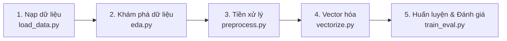

# BÀI TẬP LỚN MÔN HỌC MÁY (MACHINE LEARNING)
## Đề tài: Phân loại chủ đề bài báo

Dự án triển khai quy trình hoàn chỉnh từ thu thập, khám phá dữ liệu (EDA), tiền xử lý văn bản tiếng Việt & tiếng Anh, trích xuất đặc trưng đa dạng (BoW, TF-IDF, Sentence Embeddings), đến huấn luyện và so sánh hiệu năng của 7 giải thuật Machine Learning (Naive Bayes, Logistic Regression, SVM, Decision Tree, Random Forest, KNN, MLP). Dự án có kèm giao diện trực quan xây dựng bằng Streamlit.

---

## 📁 1. Cấu trúc thư mục

```text
BTL_HocMay/
├── data/                    # Chứa tập dữ liệu thô và dữ liệu sau tiền xử lý (processed_data.csv)
├── src/                     # Mã nguồn chính theo từng module
│   ├── load_data.py         # Nạp dữ liệu từ Hugging Face Cache
│   ├── eda.py               # Khám phá dữ liệu & xuất biểu đồ phân phối nhãn
│   ├── preprocess.py        # Làm sạch văn bản & tách từ tiếng Việt (pyvi)
│   ├── vectorize.py         # Trích xuất đặc trưng (BoW, TF-IDF, Sentence Embeddings)
│   └── train_eval.py        # Huấn luyện 4 thuật toán ML & đánh giá chỉ số
├── outputs/                 # Lưu biểu đồ (.png) và bảng kết quả (.csv, .tex cho LaTeX)
├── main.py                  # Script chính gọi liên hoàn từ A đến Z
├── app.py                   # Giao diện Web GUI bằng Streamlit (điểm thưởng)
├── requirements.txt         # Danh sách thư viện sử dụng
└── README.md                # Báo cáo hướng dẫn chạy mã nguồn
```

---

## 🔬 2. Cách hoạt động & Quy trình xử lý

Dự án hoạt động theo pipeline 5 bước tuần tự. Mỗi bước được đóng gói thành một module riêng trong `src/`, được gọi liên hoàn bởi `main.py`.



### Bước 1: Nạp dữ liệu (`src/load_data.py`)
- **Nguồn dữ liệu:** Tập `UniverseTBD/arxiv-abstracts-large` (~2.29 triệu bài tóm tắt khoa học từ arXiv) được lưu sẵn trong thư mục `huggingface_cache/`.
- **Xử lý:** Sử dụng thư viện `datasets` của Hugging Face để nạp từ cache local (không cần kết nối mạng sau lần tải đầu tiên), hỗ trợ lấy mẫu con (`sample_size`) để tiết kiệm RAM.
- **Đầu ra:** Một `pandas.DataFrame` với các cột chính gồm `abstract` (nội dung tóm tắt) và `categories` (nhãn phân loại lĩnh vực khoa học, ví dụ: `hep-ph`, `astro-ph`, `quant-ph`).

### Bước 2: Khám phá dữ liệu — EDA (`src/eda.py`)
- **Thống kê:** Đếm tổng số mẫu, tính phân phối độ dài văn bản theo số từ (min, max, mean, std), và đếm tần suất xuất hiện của từng nhãn.
- **Trực quan hóa:** Vẽ biểu đồ cột (Bar Chart) Top 15 nhãn phổ biến nhất bằng `seaborn`/`matplotlib` → Lưu tự động ra `outputs/label_distribution.png` (300 DPI, sẵn sàng chèn vào báo cáo LaTeX).

### Bước 3: Tiền xử lý văn bản (`src/preprocess.py`)
Quy trình làm sạch mỗi văn bản qua 2 giai đoạn nối tiếp:

1. **`clean_text(text)`** — Chuẩn hóa văn bản thô:
   - Loại bỏ toàn bộ thẻ HTML (`<tag>...</tag>`)
   - Chuyển toàn bộ ký tự về chữ thường
   - Xóa chữ số, ký tự đặc biệt, dấu câu
   - Chuẩn hóa khoảng trắng thừa

2. **`tokenize_text(text)`** — Tách từ tiếng Việt:
   - Sử dụng `ViTokenizer` từ thư viện `pyvi` để ghép các từ ghép tiếng Việt bằng dấu gạch dưới (ví dụ: `trí tuệ nhân tạo` → `trí_tuệ nhân_tạo`)
   - Tương thích tốt với cả văn bản tiếng Anh

- **Nhãn:** Chuẩn hóa cột `categories` bằng cách lấy nhãn chính đầu tiên (ví dụ: `"math.CO cs.CG"` → `"math.CO"`).
- **Đầu ra:** DataFrame 2 cột (`cleaned_text`, `label`) được lưu ra file `data/processed_data.csv`.

### Bước 4: Vector hóa — Trích xuất đặc trưng (`src/vectorize.py`)
Văn bản sau khi làm sạch được chuyển thành 3 bộ vector số độc lập để các thuật toán ML có thể xử lý:

| Phương pháp | Thư viện | Cách hoạt động | Kích thước vector |
|---|---|---|---|
| **Bag-of-Words (BoW)** | `CountVectorizer` (scikit-learn) | Đếm tần suất xuất hiện của từng từ trong tập từ vựng. Vector thưa (sparse), mỗi chiều = số lần một từ xuất hiện. | tối đa 5000 chiều |
| **TF-IDF** | `TfidfVectorizer` (scikit-learn) | Cải tiến BoW: nhân tần suất từ (TF) với nghịch đảo tần suất tài liệu (IDF) → giảm trọng số từ phổ biến, tăng trọng số từ đặc trưng. | tối đa 5000 chiều |
| **Sentence Embeddings** | `SentenceTransformer` (sentence-transformers) | Sử dụng mô hình pre-trained đa ngôn ngữ `paraphrase-multilingual-MiniLM-L12-v2` để mã hóa toàn bộ câu thành vector dense, nắm bắt ngữ nghĩa sâu hơn. | 384 chiều |

### Bước 5: Huấn luyện & Đánh giá (`src/train_eval.py`)

**Phân chia dữ liệu:**
- Lọc Top 12 nhãn phổ biến nhất để đảm bảo đủ mẫu cho phân tầng.
- Chia Train/Test theo tỉ lệ 80/20 với `stratify` (đảm bảo tỉ lệ nhãn giữ nguyên ở cả train và test).

**7 thuật toán được huấn luyện trên mỗi bộ vector (tổng cộng 21 thí nghiệm):**

| Thuật toán | Mô tả ngắn | Ghi chú |
|---|---|---|
| **Naive Bayes** | Phân loại xác suất dựa trên định lý Bayes | `MultinomialNB` cho BoW/TF-IDF, `GaussianNB` cho Embeddings (vì Embeddings chứa giá trị âm) |
| **Logistic Regression** | Hồi quy logistic đa lớp | `max_iter=1000` |
| **SVM** | Máy vector hỗ trợ tuyến tính | `LinearSVC` |
| **Decision Tree** | Cây quyết định phân loại nhị phân/đa lớp | `DecisionTreeClassifier` |
| **Random Forest** | Rừng ngẫu nhiên (tập hợp nhiều cây quyết định) | `n_estimators=100` |
| **KNN** | Thuật toán láng giềng gần nhất | `n_neighbors=5`, khoảng cách cosine cho Embeddings |
| **MLP (Neural Net)** | Mạng nơ-ron nhân tạo đa tầng | 2 ẩn tầng `(128, 64)`, tối ưu bằng Adam |

**Chỉ số đánh giá:** Accuracy, Precision, Recall, F1-Score (cả Macro và Weighted).

**Biểu đồ đầu ra tự động:**
- `outputs/f1_comparison.png` — Biểu đồ cột so sánh F1-Macro của 4 thuật toán × 3 bộ đặc trưng.
- `outputs/confusion_matrix.png` — Ma trận nhầm lẫn của tổ hợp đạt F1-Macro cao nhất.
- `outputs/evaluation_results.csv` & `outputs/evaluation_table.tex` — Bảng kết quả dạng CSV và LaTeX.

---

## ⚙️ 3. Hướng dẫn Cài đặt Môi trường

Khuyến nghị sử dụng Python 3.10 trở lên. Mở Terminal / PowerShell tại thư mục dự án và thực hiện:

### Bước 1: Tạo và kích hoạt môi trường ảo (tùy chọn nhưng khuyến nghị)
```bash
# Windows
python -m venv venv
venv\Scripts\activate

# Linux / macOS
python3 -m venv venv
source venv/bin/activate
```

### Bước 2: Cài đặt các thư viện cần thiết
```bash
pip install -r requirements.txt
```

---

## 🚀 4. Hướng dẫn Chạy Dự án

##

python -m streamlit run app.py

### Cách 1: Chạy toàn bộ quy trình từ A đến Z (Khuyến nghị)
Chạy script chính để tự động thực hiện: Nạp dữ liệu $\to$ EDA $\to$ Tiền xử lý $\to$ Vector hóa $\to$ Huấn luyện & Đánh giá:
```bash
python main.py
```
Sau khi hoàn thành, toàn bộ biểu đồ và bảng kết quả sẽ được lưu vào thư mục `outputs/`:
* `outputs/label_distribution.png`: Biểu đồ phân phối nhãn.
* `outputs/f1_comparison.png`: Biểu đồ cột so sánh F1-Score giữa các phương pháp trích xuất đặc trưng.
* `outputs/confusion_matrix.png`: Ma trận nhầm lẫn của mô hình đạt F1 cao nhất.
* `outputs/evaluation_results.csv` & `outputs/evaluation_table.tex`: Bảng kết quả sẵn sàng chèn vào báo cáo LaTeX.

---

### Cách 2: Khởi chạy Giao diện Web Trực quan (GUI Streamlit)
Để tương tác trực tiếp, nhập văn bản tùy ý và dự đoán nhãn:
```bash
streamlit run app.py
```
Giao diện sẽ tự động mở tại trình duyệt theo địa chỉ `http://localhost:8501`. Người dùng có thể:
1. Lựa chọn thuật toán và phương pháp vector hóa.
2. Nhập văn bản bất kỳ và bấm **Dự đoán nhãn (Predict)**.
3. Xem trực quan các biểu đồ thực nghiệm (EDA, F1-Score, Confusion Matrix) ngay trên ứng dụng.

---

### Cách 3: Chạy độc lập từng Module con (Debug / Kiểm thử)
* Nạp dữ liệu:
  ```bash
  python -m src.load_data
  ```
* Phân tích khám phá dữ liệu (EDA):
  ```bash
  python -m src.eda
  ```
* Tiền xử lý & tách từ tiếng Việt:
  ```bash
  python -m src.preprocess
  ```
* Trích xuất vector đặc trưng:
  ```bash
  python -m src.vectorize
  ```
* Huấn luyện & Đánh giá mô hình:
  ```bash
  python -m src.train_eval
  ```

---

## 📊 5. Tóm tắt Kết quả Thực nghiệm

Thực nghiệm so sánh 21 tổ hợp (7 thuật toán × 3 bộ đặc trưng) trên **12 lớp chủ đề bài báo**, được sắp xếp theo F1-Macro giảm dần:

| Bộ đặc trưng | Thuật toán | Accuracy | F1-Macro | F1-Weighted |
|---|---|---|---|---|
| **Embeddings** | **Logistic Regression** | **78.51%** | **0.724** | **0.782** |
| **Embeddings** | **MLP (Neural Net)** | **77.69%** | **0.708** | **0.772** |
| **Embeddings** | **SVM** | **74.38%** | **0.681** | **0.740** |
| Embeddings | Naive Bayes | 73.55% | 0.678 | 0.736 |
| TF-IDF | SVM | 71.07% | 0.581 | 0.680 |
| TF-IDF | MLP (Neural Net) | 71.90% | 0.548 | 0.685 |
| TF-IDF | KNN | 62.81% | 0.513 | 0.607 |
| BoW | MLP (Neural Net) | 69.42% | 0.504 | 0.653 |
| Embeddings | KNN | 66.94% | 0.498 | 0.643 |
| BoW | SVM | 59.50% | 0.481 | 0.587 |
| BoW | Logistic Regression | 59.50% | 0.429 | 0.581 |
| BoW | Naive Bayes | 65.29% | 0.416 | 0.593 |
| BoW | Decision Tree | 47.93% | 0.353 | 0.474 |
| Embeddings | Random Forest | 56.20% | 0.336 | 0.500 |
| BoW | Random Forest | 53.72% | 0.319 | 0.456 |
| Embeddings | Decision Tree | 47.11% | 0.301 | 0.451 |
| TF-IDF | Decision Tree | 45.45% | 0.288 | 0.447 |
| TF-IDF | Random Forest | 49.59% | 0.240 | 0.401 |
| TF-IDF | Logistic Regression | 46.28% | 0.212 | 0.366 |
| BoW | KNN | 33.88% | 0.174 | 0.312 |
| TF-IDF | Naive Bayes | 31.40% | 0.040 | 0.150 |

**Nhận xét:**
* Khi mở rộng lên **12 chủ đề bài báo** (bài toán phân loại 12 lớp phức tạp hơn nhiều so với 5 lớp), **Sentence Embeddings** chứng minh ưu thế tuyệt đối khi chiếm trọn Top 4 vị trí dẫn đầu, với **Logistic Regression** (Accuracy: **78.51%**, F1-Macro: **0.724**) và **MLP** (Accuracy: **77.69%**, F1-Macro: **0.708**).
* **TF-IDF + Linear SVM** vẫn là sự kết hợp truyền thống mạnh nhất (Accuracy: **71.07%**, F1-Macro: **0.581**).
* Ma trận nhầm lẫn (Confusion Matrix 12×12) thể hiện rõ khả năng phân tách rất tốt của các nhãn `astro-ph`, `quant-ph`, `gr-qc`, `math.PR`.

Các kết quả chi tiết được tổng hợp tự động trong file `outputs/evaluation_results.csv` và bảng LaTeX `outputs/evaluation_table.tex`.

---

## 💡 6. Các câu ví dụ mẫu thử nghiệm trên Web GUI (app.py)

Bạn có thể copy các đoạn văn mẫu sau vào giao diện Web để kiểm thử khả năng dự đoán:

* **Ví dụ 1 (Chủ đề thiên văn / vũ trụ):**
  > *"We present observations of distant galaxies, black holes and cosmic microwave background radiation using modern space telescopes."*
  * $\to$ **Dự đoán:** `astro-ph` (Astrophysics).

* **Ví dụ 2 (Chủ đề vật lý lượng tử):**
  > *"We study quantum entanglement, qubits state teleportation and decoherence in quantum computing circuits."*
  * $\to$ **Dự đoán:** `quant-ph` (Quantum Physics).

* **Ví dụ 3 (Chủ đề hạt cơ bản / năng lượng cao):**
  > *"Calculation of prompt diphoton production cross sections at Tevatron and LHC energies using perturbative quantum chromodynamics."*
  * $\to$ **Dự đoán:** `hep-ph` (High Energy Physics - Phenomenology).
