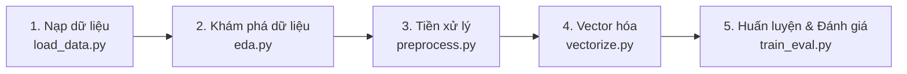

# BÀI TẬP LỚN MÔN HỌC MÁY (MACHINE LEARNING)
## Đề tài: Phân loại chủ đề bài báo

Dự án triển khai quy trình hoàn chỉnh từ thu thập, khám phá dữ liệu (EDA), tiền xử lý văn bản tiếng Việt & tiếng Anh, trích xuất đặc trưng đa dạng (BoW, TF-IDF, Sentence Embeddings), đến huấn luyện và so sánh:
- **Học có giám sát (Supervised Learning):** 7 giải thuật Machine Learning (Naive Bayes, Logistic Regression, SVM, Decision Tree, Random Forest, KNN, MLP).
- **Học không giám sát (Unsupervised Learning):** Phân cụm K-Means Clustering trên 12 cụm chủ đề, đánh giá bằng Silhouette Score, Adjusted Rand Index (ARI) và Normalized Mutual Information (NMI).
Dự án có kèm giao diện trực quan xây dựng bằng Streamlit.

---

## 📁 1. Cấu trúc thư mục

```text
BTL_HocMay/
├── data/                    # Chứa tập dữ liệu thô và dữ liệu sau tiền xử lý (processed_data.csv)
├── src/                     # Mã nguồn chính theo từng module
│   ├── load_data.py         # Nạp dữ liệu từ Hugging Face Cache
│   ├── eda.py               # Khám phá dữ liệu & xuất biểu đồ phân phối nhãn
│   ├── preprocess.py        # Làm sạch văn bản & tách từ tiếng Việt (pyvi)
│   ├── vectorize.py         # Trích xuất đặc trưng (BoW, TF-IDF kết hợp N-gram + Stopwords, Sentence Embeddings)
│   └── train_eval.py        # Huấn luyện 7 thuật toán có giám sát, phân cụm K-Means, vẽ biểu đồ 2D PCA/t-SNE & đánh giá chỉ số
├── outputs/                 # Lưu biểu đồ (.png) và bảng kết quả (.csv, .tex cho LaTeX)
├── main.py                  # Script chính gọi liên hoàn từ A đến Z
├── app.py                   # Giao diện Web GUI bằng Streamlit (điểm thưởng)
├── requirements.txt         # Danh sách thư viện sử dụng
└── README.md                # Báo cáo hướng dẫn chạy mã nguồn
```

---

## 🔬 2. Cách hoạt động & Quy trình xử lý

Dự án hoạt động theo pipeline 5 bước tuần tự. Mỗi bước được đóng gói thành một module riêng trong `src/`, được gọi liên hoàn bởi `main.py`.



### Bước 1: Nạp dữ liệu (`src/load_data.py`)
- **Nguồn dữ liệu:** Tập `UniverseTBD/arxiv-abstracts-large` (~2.29 triệu bài tóm tắt khoa học từ arXiv) được lưu sẵn trong thư mục `huggingface_cache/`.
- **Xử lý:** Sử dụng thư viện `datasets` của Hugging Face để nạp từ cache local (không cần kết nối mạng sau lần tải đầu tiên), hỗ trợ lấy mẫu con (`sample_size`) để tiết kiệm RAM.
- **Đầu ra:** Một `pandas.DataFrame` với các cột chính gồm `abstract` (nội dung tóm tắt) và `categories` (nhãn phân loại lĩnh vực khoa học, ví dụ: `hep-ph`, `astro-ph`, `quant-ph`).

### Bước 2: Khám phá dữ liệu — EDA (`src/eda.py`)
- **Thống kê:** Đếm tổng số mẫu, tính phân phối độ dài văn bản theo số từ (min, max, mean, std), và đếm tần suất xuất hiện của từng nhãn.
- **Trực quan hóa:** Vẽ biểu đồ cột (Bar Chart) Top 15 nhãn phổ biến nhất bằng `seaborn`/`matplotlib` → Lưu tự động ra `outputs/label_distribution.png` (300 DPI, sẵn sàng chèn vào báo cáo LaTeX).

### Bước 3: Tiền xử lý văn bản tiếng Anh (`src/preprocess.py`)
Quy trình làm sạch tối ưu cho dữ liệu học thuật arXiv:

1. **Gộp văn bản đầu vào:**
   - Kết hợp tiêu đề (`title`) và phần tóm tắt (`abstract`) thành một trường văn bản thống nhất:
     $$\text{text} = \text{title} + \text{". "} + \text{abstract}$$
   - Tiêu đề chứa các từ khóa domain quan trọng nhất, giúp tăng tín hiệu ngữ nghĩa vượt trội.

2. **Hàm làm sạch chuẩn hóa `clean_text(text)`:**
   - Loại bỏ hoàn toàn thư viện `pyvi` (do văn bản 100% tiếng Anh khoa học).
   - Loại bỏ thẻ HTML (`<tag>...</tag>`), ký tự xuống dòng (`\n`), tab (`\t`), dấu câu và ký tự đặc biệt.
   - Chuyển toàn bộ về chữ thường (`lowercase`) và chuẩn hóa khoảng trắng thừa.
   - **Bảo toàn chữ số (`digits`):** Giữ lại các con số từ 0 đến 9 nhằm bảo toàn các định danh mô hình (`GPT-4`, `BERT-2`), chiều không gian (`2D`, `3D`), và các hằng số/ký hiệu vật lý.

- **Nhãn:** Chuẩn hóa cột `categories` bằng cách lấy nhãn chuyên ngành chính đầu tiên (ví dụ: `"math.CO cs.CG"` $\to$ `"math.CO"`).
- **Đầu ra:** DataFrame gồm 2 cột (`cleaned_text`, `label`) được lưu ra file `data/processed_data.csv`.

### Bước 4: Vector hóa — Trích xuất đặc trưng (`src/vectorize.py`)
Văn bản sau khi làm sạch được chuyển thành 3 bộ biểu diễn đặc trưng độc lập với cấu hình tối ưu:

| Phương pháp | Thư viện | Cách hoạt động & Cấu hình | Kích thước vector |
|---|---|---|---|
| **Bag-of-Words (BoW)** | `CountVectorizer` (scikit-learn) | Đếm tần suất từ vựng kết hợp **N-gram (1, 2)**, loại bỏ từ dừng `english`, `max_features=12000`, `min_df=3`. Vector thưa (sparse). | tối đa 12.000 chiều |
| **TF-IDF** | `TfidfVectorizer` (scikit-learn) | Trọng số TF-IDF kết hợp **N-gram (1, 2)**, loại bỏ từ dừng `english`, `max_features=12000`, `min_df=3`. Tăng trọng số từ khóa chuyên môn. | tối đa 12.000 chiều |
| **Sentence Embeddings** | `SentenceTransformer` | Mô hình `paraphrase-multilingual-MiniLM-L12-v2`, tự động nhận diện GPU (`cuda`), `batch_size=128`. Mã hóa ngữ nghĩa toàn câu. | 384 chiều |

### Bước 5: Huấn luyện & Đánh giá (`src/train_eval.py`)

**Phân chia dữ liệu:**
- Lọc Top 12 nhãn phổ biến nhất để đảm bảo đủ mẫu cho phân tầng.
- Chia Train/Test theo tỉ lệ 80/20 với `stratify` (đảm bảo tỉ lệ nhãn giữ nguyên ở cả train và test).

**7 thuật toán được huấn luyện trên mỗi bộ vector (tổng cộng 21 thí nghiệm):**

| Thuật toán | Mô tả ngắn | Ghi chú |
|---|---|---|
| **Naive Bayes** | Phân loại xác suất dựa trên định lý Bayes | `MultinomialNB` cho BoW/TF-IDF, `GaussianNB` cho Embeddings (vì Embeddings chứa giá trị âm) |
| **Logistic Regression** | Hồi quy logistic đa lớp | `max_iter=1000` |
| **SVM** | Máy vector hỗ trợ tuyến tính | `LinearSVC` |
| **Decision Tree** | Cây quyết định phân loại nhị phân/đa lớp | `DecisionTreeClassifier` |
| **Random Forest** | Rừng ngẫu nhiên (tập hợp nhiều cây quyết định) | `n_estimators=100` |
| **KNN** | Thuật toán láng giềng gần nhất | `n_neighbors=5`, khoảng cách cosine cho Embeddings |
| **MLP (Neural Net)** | Mạng nơ-ron nhân tạo đa tầng | 2 ẩn tầng `(128, 64)`, tối ưu bằng Adam |

**Chỉ số đánh giá:**
- **Học có giám sát:** Accuracy, Precision, Recall, F1-Score (cả Macro và Weighted).
- **Học không giám sát (K-Means):** Silhouette Score (đo độ kết cụm nội tại), Adjusted Rand Index - ARI (đo mức độ tương đồng phân cụm với nhãn thực tế), Normalized Mutual Information - NMI (đo lượng thông tin chia sẻ giữa các cụm và các nhãn).

**Biểu đồ và bảng đầu ra tự động:**
- `outputs/f1_comparison.png` — Biểu đồ cột so sánh F1-Macro của 7 thuật toán × 3 bộ đặc trưng.
- `outputs/confusion_matrix.png` — Ma trận nhầm lẫn ($12 \times 12$) của mô hình đạt F1-Macro cao nhất.
- `outputs/clusters_2d.png` — Biểu đồ phân cụm không gian 2D (PCA & t-SNE) của 12 lớp chủ đề bài báo.
- `outputs/kmeans_clustering.png` — Biểu đồ cột so sánh chất lượng phân cụm K-Means (Silhouette, ARI, NMI) giữa 3 phương pháp đặc trưng.
- `outputs/evaluation_results.csv` & `outputs/evaluation_table.tex` — Bảng kết quả phân loại có giám sát dạng CSV và LaTeX.
- `outputs/kmeans_results.csv` & `outputs/kmeans_table.tex` — Bảng kết quả phân cụm K-Means dạng CSV và LaTeX.

---

## ⚙️ 3. Hướng dẫn Cài đặt Môi trường

Khuyến nghị sử dụng Python 3.10 trở lên. Mở Terminal / PowerShell tại thư mục dự án và thực hiện:

### Bước 1: Tạo và kích hoạt môi trường ảo (tùy chọn nhưng khuyến nghị)
```bash
# Windows
python -m venv venv
venv\Scripts\activate

# Linux / macOS
python3 -m venv venv
source venv/bin/activate
```

### Bước 2: Cài đặt các thư viện cần thiết
```bash
pip install -r requirements.txt
```

---

## 🚀 4. Hướng dẫn Chạy Dự án

python -m streamlit run app.py

### Cách 1: Chạy toàn bộ quy trình từ A đến Z (Khuyến nghị)
Chạy script chính để tự động thực hiện: Nạp dữ liệu $\to$ EDA $\to$ Tiền xử lý $\to$ Vector hóa $\to$ Huấn luyện & Đánh giá:
```bash
python main.py
```
Sau khi hoàn thành, toàn bộ biểu đồ và bảng kết quả sẽ được lưu vào thư mục `outputs/`:
* `outputs/label_distribution.png`: Biểu đồ phân phối nhãn.
* `outputs/f1_comparison.png`: Biểu đồ cột so sánh F1-Score giữa các phương pháp trích xuất đặc trưng.
* `outputs/confusion_matrix.png`: Ma trận nhầm lẫn của mô hình đạt F1 cao nhất.
* `outputs/clusters_2d.png`: Biểu đồ phân cụm không gian đặc trưng 2D bằng PCA và t-SNE.
* `outputs/kmeans_clustering.png`: Biểu đồ so sánh phân cụm K-Means không giám sát (Silhouette, ARI, NMI).
* `outputs/evaluation_results.csv` & `outputs/evaluation_table.tex`: Bảng kết quả phân loại có giám sát (CSV & LaTeX).
* `outputs/kmeans_results.csv` & `outputs/kmeans_table.tex`: Bảng kết quả phân cụm K-Means không giám sát (CSV & LaTeX).

---

### Cách 2: Khởi chạy Giao diện Web Trực quan (GUI Streamlit)
Để tương tác trực tiếp, nhập văn bản tùy ý và dự đoán nhãn:
```bash
streamlit run app.py
```
Giao diện sẽ tự động mở tại trình duyệt theo địa chỉ `http://localhost:8501`. Người dùng có thể:
1. Lựa chọn thuật toán và phương pháp vector hóa.
2. Nhập văn bản bất kỳ và bấm **Dự đoán nhãn (Predict)**.
3. Xem trực quan các biểu đồ thực nghiệm (EDA, F1-Score, Confusion Matrix) ngay trên ứng dụng.

---

### Cách 3: Chạy độc lập từng Module con (Debug / Kiểm thử)
* Nạp dữ liệu:
  ```bash
  python -m src.load_data
  ```
* Phân tích khám phá dữ liệu (EDA):
  ```bash
  python -m src.eda
  ```
* Tiền xử lý & tách từ tiếng Việt:
  ```bash
  python -m src.preprocess
  ```
* Trích xuất vector đặc trưng:
  ```bash
  python -m src.vectorize
  ```
* Huấn luyện & Đánh giá mô hình:
  ```bash
  python -m src.train_eval
  ```

---

## 📊 5. Tóm tắt Kết quả Thực nghiệm

### 5.1. Học có giám sát (Supervised Learning - 7 thuật toán)

Thực nghiệm so sánh 21 tổ hợp (7 thuật toán × 3 bộ đặc trưng) trên **2.941 mẫu bài báo thuộc Top 12 chuyên ngành** (nạp từ 5.000 mẫu thô ban đầu, gộp **Title + Abstract**, giữ **chữ số**, cấu hình **N-gram (1, 2) + 12.000 max features**), được sắp xếp theo F1-Macro giảm dần:

| Bộ đặc trưng | Thuật toán | Accuracy | F1-Macro | F1-Weighted |
|---|---|---|---|---|
| **TF-IDF** | **MLP (Neural Net)** | **80.98%** | **0.7312** | **0.8077** |
| **BoW** | **MLP (Neural Net)** | **78.95%** | **0.7168** | **0.7883** |
| **TF-IDF** | **SVM** | **78.78%** | **0.7141** | **0.7823** |
| **BoW** | **Logistic Regression** | **75.89%** | **0.6799** | **0.7551** |
| **BoW** | **Naive Bayes** | **77.25%** | **0.6773** | **0.7706** |
| **BoW** | **SVM** | **74.53%** | **0.6592** | **0.7429** |
| **TF-IDF** | **KNN** | **75.21%** | **0.6478** | **0.7447** |
| **Embeddings** | **Logistic Regression** | **71.48%** | **0.6287** | **0.7109** |
| **Embeddings** | **SVM** | **70.80%** | **0.6165** | **0.7040** |
| **Embeddings** | **Naive Bayes** | **68.59%** | **0.6156** | **0.6959** |
| Embeddings | MLP (Neural Net) | 70.29% | 0.6088 | 0.7008 |
| TF-IDF | Logistic Regression | 70.63% | 0.6078 | 0.6808 |
| BoW | Random Forest | 69.44% | 0.5797 | 0.6672 |
| Embeddings | KNN | 68.93% | 0.5738 | 0.6830 |
| TF-IDF | Random Forest | 68.59% | 0.5684 | 0.6558 |
| Embeddings | Random Forest | 62.99% | 0.4726 | 0.5926 |
| BoW | Decision Tree | 58.40% | 0.4610 | 0.5797 |
| TF-IDF | Decision Tree | 57.73% | 0.4352 | 0.5663 |
| TF-IDF | Naive Bayes | 57.05% | 0.3482 | 0.4932 |
| Embeddings | Decision Tree | 42.78% | 0.2798 | 0.4173 |
| BoW | KNN | 28.01% | 0.1870 | 0.3111 |

**Nhận xét mô hình có giám sát:**
* **Hiệu năng ấn tượng trên quy mô 5.000 mẫu:**
  - Mô hình dẫn đầu: **TF-IDF + MLP (Mạng nơ-ron)** đạt **Accuracy 80.98%** và **F1-Macro 0.7312** (F1-Weighted đạt **80.77%**).
  - **BoW + MLP** và **TF-IDF + SVM** bám sát nút với độ chính xác xấp xỉ **79%**, F1-Macro đạt trên **0.714**.
  - Tiêu đề (Title) cung cấp các thuật ngữ cốt lõi, trong khi việc giữ chữ số (`2D`, `3D`, `GPT-4`, `TeV`) giúp các mô hình phân biệt rạch ròi các khái niệm vật lý và toán học.
* **Nguyên tắc ghép cặp mô hình & đặc trưng chuẩn xác:**
  - Với BoW/TF-IDF (ma trận thưa): `MultinomialNB` phát huy tối đa xác suất đếm rời rạc.
  - Với Sentence Embeddings (ma trận dày có giá trị âm): `GaussianNB` và khoảng cách Cosine trong `KNN` hoạt động mượt mà và không gặp lỗi toán học.
* **Biểu đồ trực quan hóa:**
  - `outputs/f1_comparison.png`: Biểu đồ so sánh trực quan toàn diện 21 thực nghiệm.
  - `outputs/confusion_matrix.png`: Thể hiện đường chéo chính áp đảo trên cả 12 lớp chuyên ngành.
  - `outputs/clusters_2d.png`: Thể hiện các cụm toán học, vật lý thiên văn và vật lý hạt tách cụm rõ rệt.

Các kết quả chi tiết được tổng hợp tự động trong file `outputs/evaluation_results.csv` và bảng LaTeX `outputs/evaluation_table.tex`.

---

### 5.2. Học không giám sát (Unsupervised Learning - Phân cụm K-Means)

Thực nghiệm áp dụng thuật toán **K-Means ($k=12$ cụm)** độc lập trên 3 không gian biểu diễn đặc trưng (BoW, TF-IDF, Embeddings) trên **2.941 bài báo** mà hoàn toàn **không sử dụng nhãn lớp khi gom cụm**:

| Bộ đặc trưng | Số cụm ($k$) | Silhouette Score | Adjusted Rand Index (ARI) | Normalized Mutual Info (NMI) |
|---|:---:|:---:|:---:|:---:|
| **Embeddings** | 12 | **0.0339** | **0.3122** | **0.4434** |
| **TF-IDF** | 12 | 0.0076 | 0.1507 | 0.4057 |
| **BoW** | 12 | -0.0134 | 0.0012 | 0.2308 |

**Nhận xét phân cụm K-Means:**
* **Sentence Embeddings** vượt trội toàn diện cả về ARI (**0.3122**) và NMI (**0.4434**), cho thấy vector ngữ nghĩa đa chiều phản ánh cấu trúc lĩnh vực học thuật thực tế một cách cực kỳ rõ nét mà không cần bất kỳ sự can thiệp có giám sát nào.
* **TF-IDF** đạt NMI **0.4057**, cho thấy việc gộp Title + Abstract với 12.000 max features giúp gom cụm từ vựng rất hiệu quả.
* Biểu đồ trực quan hóa chất lượng phân cụm được lưu tại `outputs/kmeans_clustering.png` và bảng kết quả LaTeX tại `outputs/kmeans_table.tex`.

---

## 💡 6. Các câu ví dụ mẫu thử nghiệm trên Web GUI (app.py)

Bạn có thể copy các đoạn văn mẫu sau vào giao diện Web để kiểm thử khả năng dự đoán:

* **Ví dụ 1 (Chủ đề thiên văn / vũ trụ):**
  > *"We present observations of distant galaxies, black holes and cosmic microwave background radiation using modern space telescopes."*
  * $\to$ **Dự đoán:** `astro-ph` (Astrophysics).

* **Ví dụ 2 (Chủ đề vật lý lượng tử):**
  > *"We study quantum entanglement, qubits state teleportation and decoherence in quantum computing circuits."*
  * $\to$ **Dự đoán:** `quant-ph` (Quantum Physics).

* **Ví dụ 3 (Chủ đề hạt cơ bản / năng lượng cao):**
  > *"Calculation of prompt diphoton production cross sections at Tevatron and LHC energies using perturbative quantum chromodynamics."*
  * $\to$ **Dự đoán:** `hep-ph` (High Energy Physics - Phenomenology).
